

  <a href="https://discord.gg/Njs52aacwq">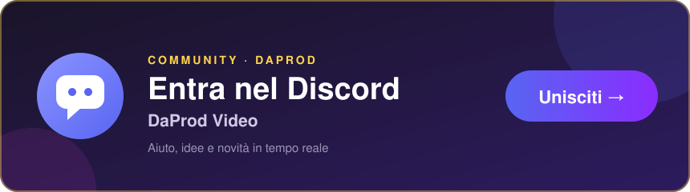</a>

  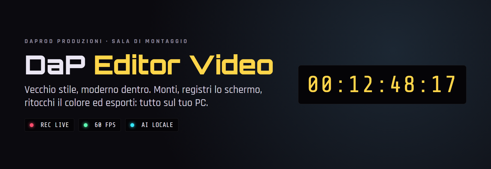

  <b>Un banco di montaggio per Windows e Mac, nello spirito delle centraline a nastro.</b> 
  Monti, registri lo schermo, ritocchi il colore ed esporti: tutto sul tuo PC, senza account e senza abbonamenti.

  
  
  
  

 

<h2 align="center">⬇&nbsp; Scarica</h2>

  <a href="https://github.com/cammo22/DaProdEditorVideo/releases/latest">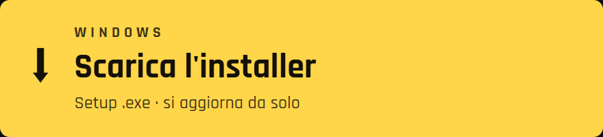</a>
  <a href="https://github.com/cammo22/DaProdEditorVideo/releases/latest">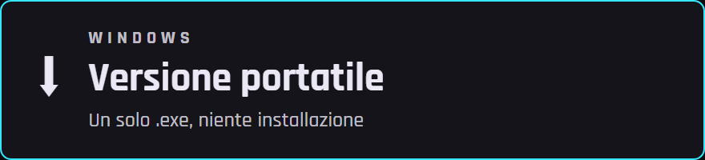</a>
  <a href="https://github.com/cammo22/DaProdEditorVideo/releases/latest">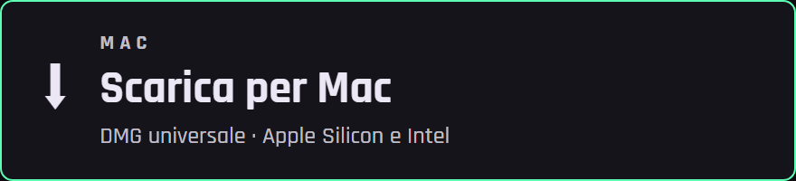</a>
  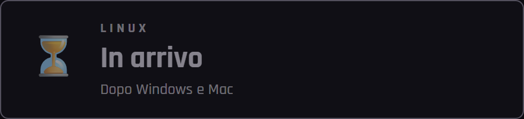

Nella pagina che si apre scegli <b>DaProd-Video-…-setup.exe</b> (installer), <b>…-portatile.exe</b> (senza installazione) o il <b>.dmg</b> per Mac. Una volta installato, il programma si aggiorna da solo.

 

<h2 align="center">Cosa sa fare</h2>

  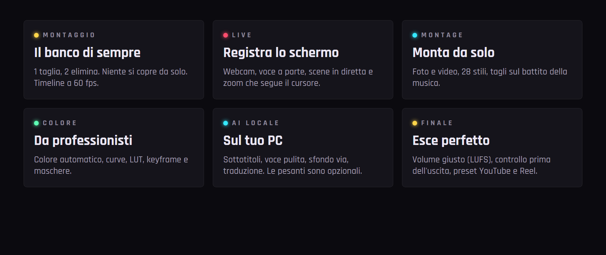

 

<h2 align="center">Guardalo all'opera</h2>

  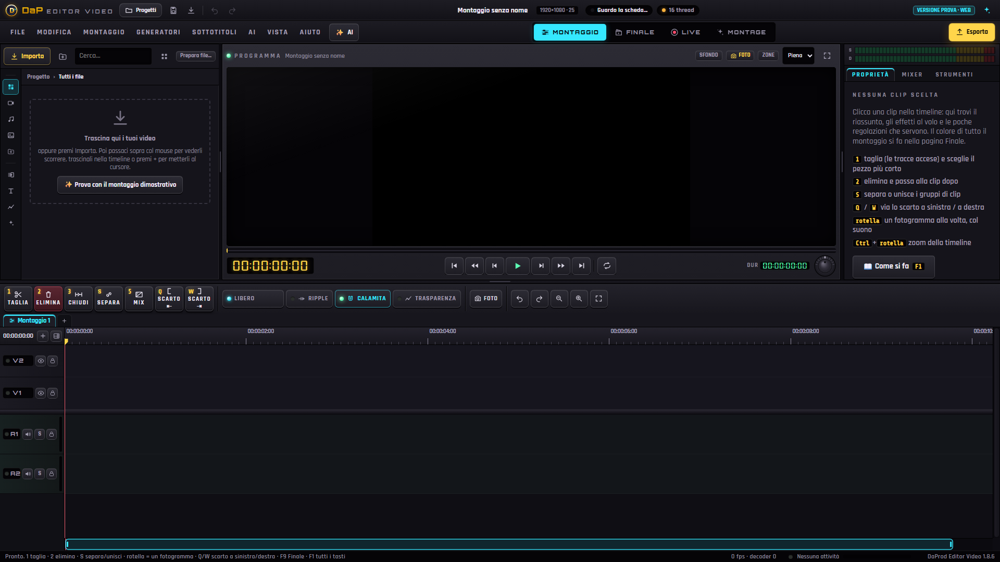

  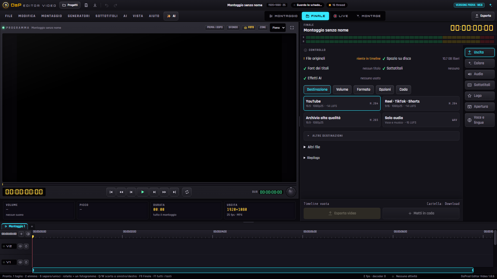

  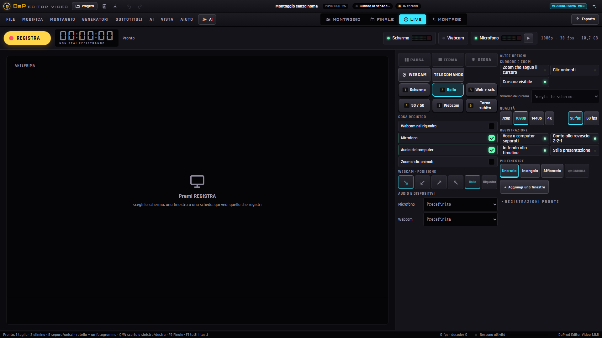

 

<h2 align="center">Le AI sono tue</h2>

  Sottotitoli, voce pulita, sfondo via, colore automatico: <b>girano sul tuo PC</b>, niente viene mandato a nessuno. 
  Quelle pesanti (voce realistica, traduzione, tagli sulle scene) sono <b>opzionali</b>: si installano solo se le scegli, 
  dal <b>Centro AI</b>, e ognuna dice quanto pesa e quanta memoria della scheda video usa. Consigliata una NVIDIA da 8 GB.

 

<h2 align="center">Come si installa</h2>

  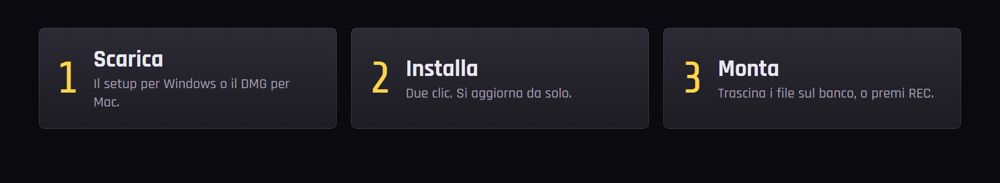

Windows può dire «Windows ha protetto il PC», perché l'installatore non ha ancora la firma a pagamento. Premi <b>Ulteriori informazioni → Esegui comunque</b>. Sul Mac, la prima volta: tasto destro sull'app → <b>Apri</b>.

 

## I tasti che contano

| Tasto | Cosa fa |
| --- | --- |
| **1** | taglia sotto la testina |
| **2** | elimina |
| **S** | separa o unisce |
| **Q / W** | tolgono lo scarto prima o dopo la testina |
| **Spazio** | play e stop |
| **Rotella** | un fotogramma alla volta, col suono · **Ctrl + rotella** zoom |
| **Ctrl + K** | cerca qualsiasi comando |
| **F1** | la guida · **F8** Montage · **F10** LIVE |

## Com'è fatto

| | |
| --- | --- |
| **L'interfaccia** | **TypeScript** senza framework, grafica «Banco»: metallo scuro, spie che si accendono solo quando serve. |
| **Il motore video** | **WebGPU / WebGL2** per il quadro, **WebCodecs** e [Mediabunny](https://mediabunny.dev) per leggere e scrivere i file: il monitor e l'esportazione fanno lo stesso conto. |
| **L'app** | **Tauri 2 / Rust**: file, progetti, registrazioni, aggiornamenti e il motore AI locale. |
| **Le AI** | Modelli aperti con licenze libere (Apache, MIT), nel programma o nel motore locale opzionale. Elenco completo in [Software di terzi](TERZE-PARTI.md). |

### Come viene sviluppato

Ogni versione ha la sua voce nel [registro delle novità](CHANGELOG.md) e passa da **oltre 330 prove automatiche**. Quando una versione è pronta, una pipeline su GitHub compila Windows e Mac e pubblica la release da sola.

 

  <b><a href="CHANGELOG.md">Novità</a></b> &nbsp;·&nbsp;
  <b><a href="TERZE-PARTI.md">Software di terzi</a></b> &nbsp;·&nbsp;
  <b><a href="https://cammo22.github.io/DaProdStore/">DaProdStore</a></b> &nbsp;·&nbsp;
  <b><a href="https://discord.gg/Njs52aacwq">Discord</a></b>

Un'app <b>DaProd Produzioni</b>, fatta con cura e in italiano.

